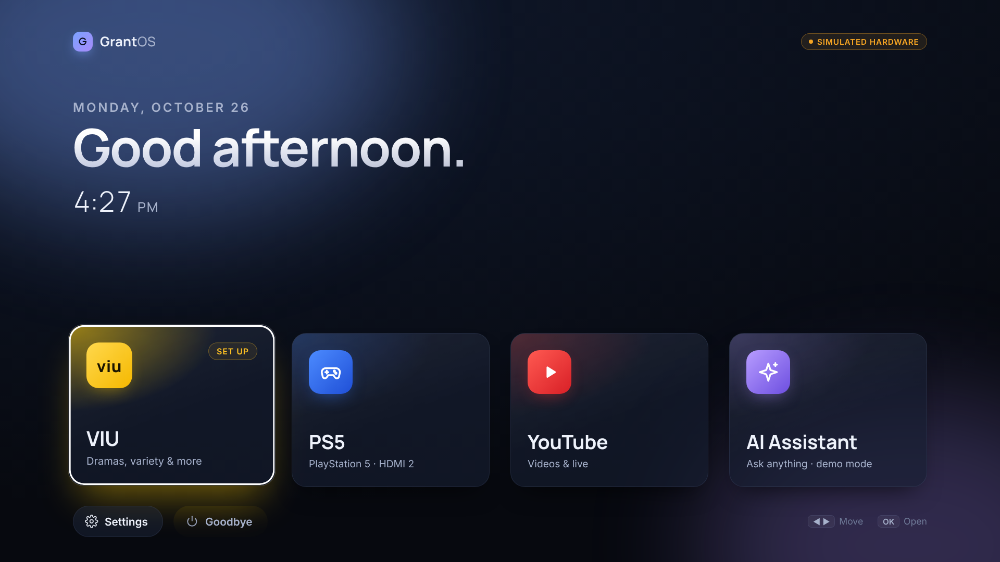
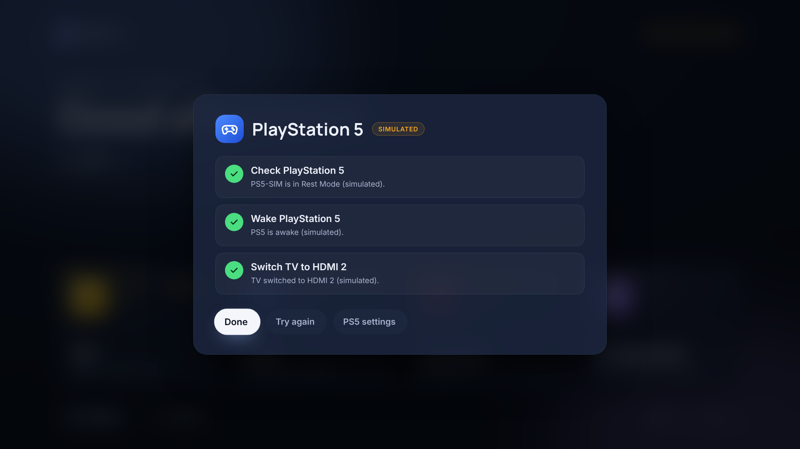
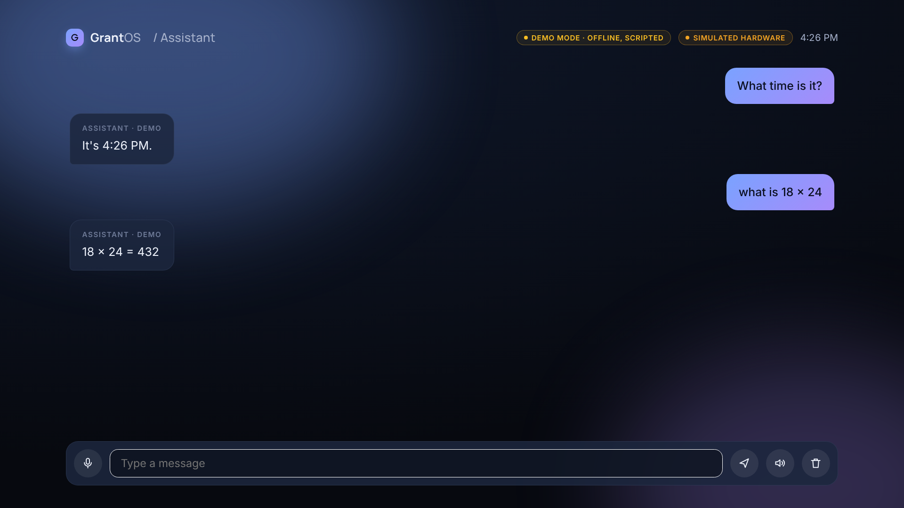
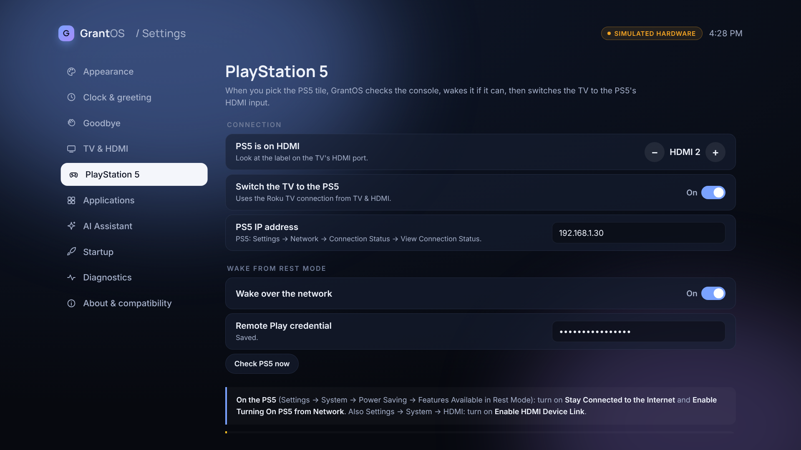
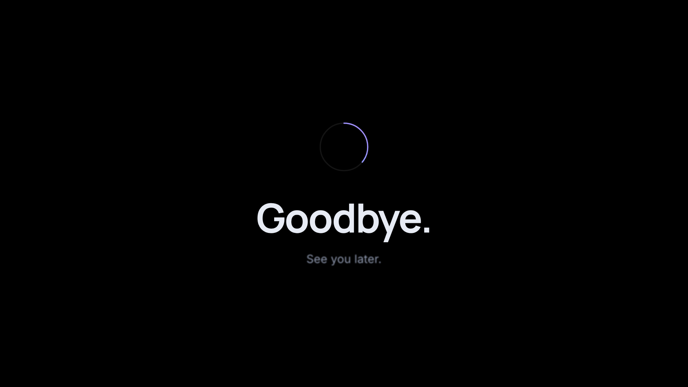

# GrantOS

A premium, ad-free TV dashboard for a **TCL Roku TV + Amazon Fire TV Stick + PS5**, built with free,
open-source software and the hardware you already own.



- **Four tiles:** VIU, PS5, YouTube, AI Assistant, with **Settings** and **Goodbye** underneath
- **Greeting** that follows the clock: *Good morning.* (5:00), *Good afternoon.* (12:00), *Good evening.* (17:00)
- **Remote-first:** every screen works with the Fire TV remote's arrows, OK and Back (keyboard on a computer)
- **VIU / YouTube** open directly through Android launch intents, not via the Amazon home screen
- **PS5:** checks the console, wakes it from Rest Mode (with a Remote Play credential), and switches the Roku
  TV to its HDMI input
- **AI Assistant:** chat, typed input, spoken replies, free offline demo mode, and any OpenAI-compatible
  service (including free local ones like Ollama)
- **Goodbye:** fade-out, your message, a short animation, then TV standby
- **Settings:** themes, wallpaper, clock, greeting, Goodbye text, HDMI inputs, app packages, AI, startup,
  diagnostics, compatibility

| | |
|---|---|
|  |  |
|  |  |

## How it works

GrantOS is an Android app on the Fire Stick (React + TypeScript UI in a WebView, with a small Java bridge).
The TV powers on to the Fire Stick's HDMI input, and a Home-button guard keeps GrantOS in front of Amazon's
home screen, so GrantOS looks like the TV's own interface. The Fire Stick controls the TV over the Roku
External Control Protocol and wakes the PS5 over the network. Details: [docs/ARCHITECTURE.md](docs/ARCHITECTURE.md).
The research and decisions behind it: [docs/RESEARCH.md](docs/RESEARCH.md).

## Status

The interface, navigation, settings, greeting, AI demo mode and Goodbye animation work and are tested. The
APK builds. **Nothing has been tested on the real TV, Fire Stick or PS5 yet**: app launching, input switching,
TV standby and PS5 wake are implemented and need a device test. Full list:
[docs/STATUS.md](docs/STATUS.md).

## Quick start

**Try it on a computer** (Node.js 20+):

```sh
cd web && npm install && npm run dev     # open http://localhost:5173 — arrows, Enter, Escape
```

**Put it on the TV:** follow [docs/DEPLOYMENT.md](docs/DEPLOYMENT.md). In short:

```sh
scripts/probe-device.sh <fire-stick-ip>   # read-only: model, Fire OS, VIU/YouTube package names
scripts/install.sh <fire-stick-ip>        # installs release/GrantOS.apk (or builds it)
```

Then go through the [hardware checklist](docs/HARDWARE-CHECKLIST.md).

**Check first:** your Fire Stick must run **Fire OS** (Settings → My Fire TV → About). Newer *Vega OS* sticks
can't sideload apps.

## Docs

- [DEPLOYMENT.md](docs/DEPLOYMENT.md): install on the Fire Stick, set up the TV
- [HARDWARE-CHECKLIST.md](docs/HARDWARE-CHECKLIST.md): what to look up, and what to test on the devices
- [PS5.md](docs/PS5.md): PS5 settings and the optional wake credential
- [STATUS.md](docs/STATUS.md): functional / needs device test / simulated / blocked
- [RESEARCH.md](docs/RESEARCH.md): repo evaluation, Roku ECP, HDMI-CEC, PS5 wake, Fire OS limits
- [ARCHITECTURE.md](docs/ARCHITECTURE.md): how the pieces fit
- [DEVELOPMENT.md](docs/DEVELOPMENT.md): preview, tests, building the APK, live editing on the TV

## Safety

No rooting, no firmware changes, no Amazon packages disabled, no API keys in the code. Installing adds one app
and one accessibility service; `scripts/uninstall.sh` removes both. Your other apps and their data aren't touched.

## Credits

Built on the approach of [Fire TV Web Launcher](https://github.com/pickdani/fire-tv-web-launcher) (MIT). Home
button behaviour on Fire OS 7/8 documented by [Home on Fire](https://github.com/toolicious/home-on-fire). PS5
discovery protocol as implemented by [pyremoteplay](https://github.com/ktnrg45/pyremoteplay). MIT licence, see
[LICENSE](LICENSE).
